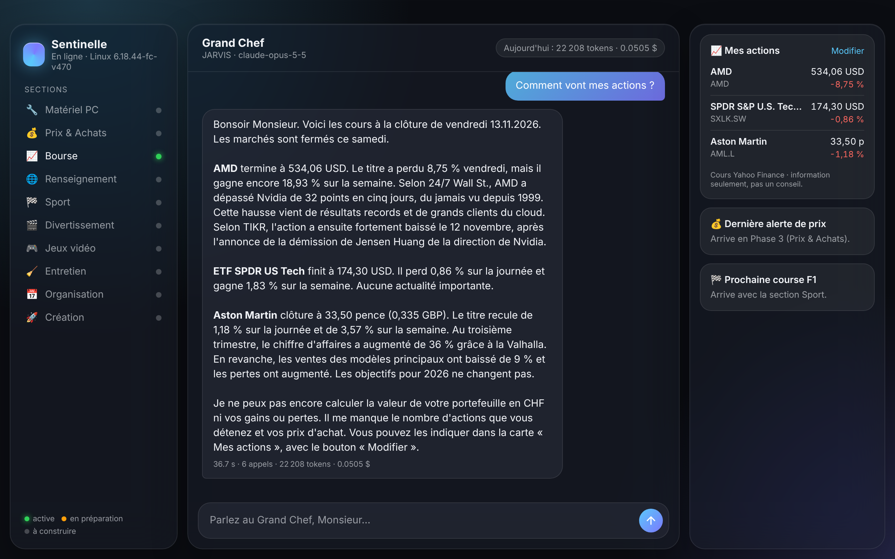
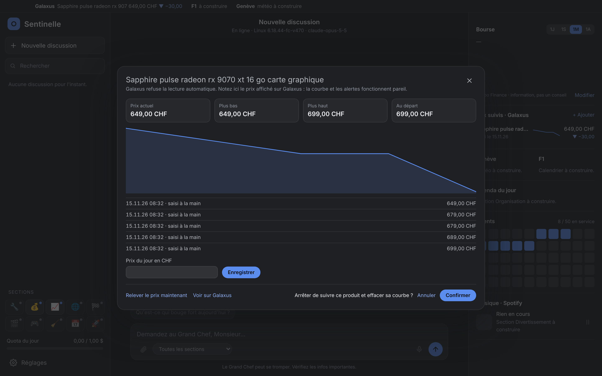
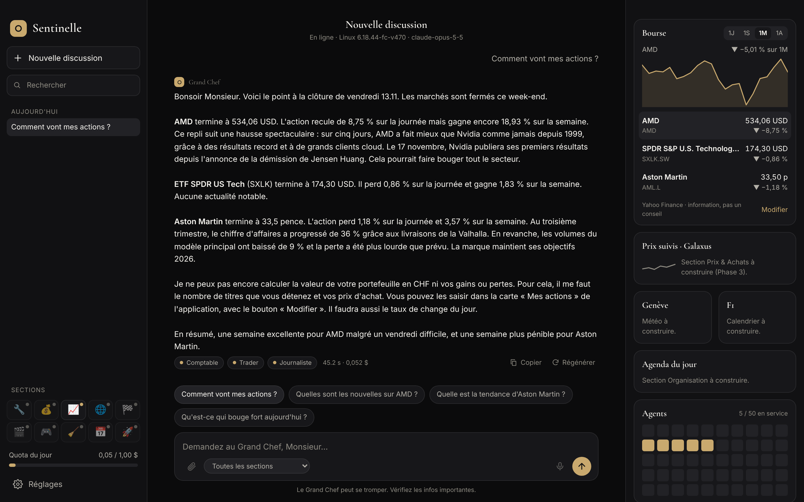

# Sentinelle — votre armée de 50 agents IA

Vous parlez à un seul agent, le **Grand Chef** (style JARVIS). Il dirige 10 commandants,
qui dirigent chacun 5 agents. Le plan complet est dans [SENTINELLE.md](SENTINELLE.md).



## Installer l'application (le plus simple)

1. Ouvrez la page **Releases** du dépôt GitHub → « Sentinelle pour Mac ».
2. Téléchargez le bon fichier : menu Apple  → « À propos de ce Mac » → ligne **Puce** (Apple M1, M2…)
   → `Sentinelle-Mac-apple.dmg` ; ligne **Processeur** (Intel) → `Sentinelle-Mac-intel.dmg`.
3. Ouvrez le `.dmg` et glissez **Sentinelle** dans le dossier **Applications**.
4. Premier lancement : macOS bloque les apps qui ne viennent pas de l'App Store.
   Ouvrez Sentinelle une fois (message de blocage → **OK**), puis allez dans
   **Réglages Système → Confidentialité et sécurité**, tout en bas : **« Ouvrir quand même »**.
   *Si macOS dit que l'app est « endommagée »*, tapez dans le Terminal :
   `xattr -cr /Applications/Sentinelle.app` puis rouvrez-la.
5. Collez votre clé API dans la discussion quand le Grand Chef vous la demande. C'est tout.

Vos données (journal, cours, portefeuille, clé) sont dans `~/Library/Application Support/Sentinelle`.
En cas de souci, le journal technique est dans `~/Library/Logs/ch.sentinelle.app/serveur.log`.

L'application est reconstruite automatiquement sur un Mac de GitHub à chaque modification
(fichier `.github/workflows/sentinelle-mac.yml`).

## Les 50 agents

**Les 50 agents sont en service.**

**Actions avec « Confirmer »** : certains agents peuvent proposer d'agir — Nettoyeur (vider les fichiers temporaires
de plus de 7 jours), Rangeur (déplacer des fichiers dans des sous-dossiers, uniquement dans les dossiers choisis,
sans rien supprimer ni écraser), Éclairagiste (mode clair/sombre), DJ (créer une playlist Spotify privée).
L'action apparaît sous la réponse avec **Confirmer** / **Annuler** : rien n'est fait avant votre clic, et jamais deux fois.

| Section | Agents en service | Sources |
|---|---|---|
| 🔧 Matériel PC | Conseiller, Compatibilité, Testeur, Pilotes 🍎/🪟, Performance 🍎/🪟 | infos de l'ordinateur, web |
| 💰 Prix & Achats | Chasseur, Historien, Alarme, Comparateur, Black Friday | Galaxus, web |
| 📈 Bourse | Trader, Journaliste, Comptable, Analyste, Radar | Yahoo Finance |
| 🌐 Renseignement | Éclaireur, Résumeur, Vérificateur, Traducteur, Archiviste | web, archives |
| 🏁 Sport | Stand F1, Courtside, Tribune, Coup d'envoi, Statisticien | Jolpica (F1 officiel), web |
| 🎬 Divertissement | DJ, Découvreur, Critique, Sorties, Genève Sorties | Spotify, web |
| 🎮 Jeux vidéo | Promo, Patch, Mods, Coach, Launcher 🍎/🪟 | jeux installés (Steam, Epic), web |
| 🧹 Entretien | Rangeur, Nettoyeur 🍎/🪟, Sauvegarde 🍎/🪟, Thermomètre 🍎/🪟, Éclairagiste 🍎/🪟 | ordinateur (lecture seule) |
| 📅 Organisation | Agenda, Rappels, Courrier, Météo, Briefing | lien iCal, Gmail (lecture seule), Open-Meteo |
| 🚀 Création | Codeur, Designer, Idées, Débugueur, Chef de projet | — |

- **Recherche web** : les agents marqués « web » cherchent et lisent des pages publiques, sans jamais se connecter
  à un compte, et citent leurs sources. Une question avec recherche coûte environ 3 à 6 centimes.
- **Entretien en lecture seule** : rien n'est jamais trié, nettoyé ni supprimé. Le Rangeur ne lit que les dossiers
  choisis dans **Réglages › Dossiers**.
- **Automatique** : briefing du matin à 7h30 (dans l'historique + notification), notification ~1 h avant les
  qualifications et la course de F1.

## Connecter l'agenda et Gmail (facultatif, lecture seule)

Dans **Réglages › Comptes** :
- **Agenda** : collez le **lien iCal secret** de votre agenda.
  - Google Agenda (sur ordinateur) : Paramètres › votre agenda › « Adresse secrète au format iCal ».
  - Outlook.com : Paramètres › Calendrier › Calendriers partagés › Publier un calendrier › lien ICS.
  - iCloud : app Calendrier › clic droit sur le calendrier › Partager › Calendrier public › copier le lien.
  Sentinelle ne peut que lire : elle ne crée, ne modifie et ne supprime aucun rendez-vous.
- **Gmail** : votre adresse et un **mot de passe d'application** (16 lettres) créé sur
  myaccount.google.com › Sécurité › Mots de passe des applications (la validation en deux étapes doit être active).
  Sentinelle lit seulement l'expéditeur, l'objet et la date des mails non lus, sans les marquer comme lus.
  Elle n'envoie, ne déplace et ne supprime jamais aucun mail.
- Ces accès restent sur votre ordinateur (`comptes.json`), ne sont jamais affichés ni envoyés ailleurs, et se
  retirent avec « Déconnecter » › « Confirmer ».

- **Spotify** (DJ et carte Musique) : sur developer.spotify.com › Dashboard › Create app, indiquez l'adresse de retour
  `http://127.0.0.1:8765/api/spotify/retour`, cochez « Web API », puis copiez le **Client ID** dans Réglages › Comptes
  et cliquez Connecter : acceptez sur la page Spotify qui s'ouvre. (Spotify peut exiger un compte Premium pour
  les applications personnelles et pour piloter la lecture.)

**Codeur + Claude Code** : ajoutez le dossier d'un projet dans **Réglages › Projets**, puis demandez par exemple
« Dans mon projet MonSite, mets le titre en bleu ». Après **Confirmer**, Claude Code modifie le projet — sans
terminal ni Internet, rien en dehors du dossier, budget 1 $ maximum — et chaque fichier modifié est d'abord
sauvegardé : le bouton **Annuler les modifications** remet tout comme avant (même si le chantier s'est interrompu).

**Sécurité** : une page web ouverte dans votre navigateur ne peut rien déclencher dans Sentinelle (protection CSRF) ;
seule la fenêtre de Sentinelle peut confirmer une action.

**Joindre un fichier** (📎) : fichiers texte, code, notes ou CSV jusqu'à 100 Ko. **Dicter** (🎤) : la dictée
intégrée de l'ordinateur (Windows + H sous Windows, deux fois Fn sur Mac).

**Rappels** : dites « Rappelle-moi demain à 9h de… » au Grand Chef, ou utilisez « + Rappel » dans la carte Agenda.
Une notification arrive à l'heure prévue.

## Prix & Achats — Galaxus (Phase 3)



- **Ajouter un produit** : carte « Prix suivis · Galaxus » → **+ Ajouter** → collez le lien de la page
  produit galaxus.ch → **Suivre**.
- **Relevé automatique** chaque jour à 8h (et au démarrage si 8h est passé), une seule lecture par produit.
  Sentinelle se présente honnêtement et ne contourne aucune protection.
- **Si Galaxus refuse la lecture** (cela arrive : Galaxus bloque certains programmes), la fiche du produit
  s'ouvre : notez le prix affiché sur Galaxus dans « Prix du jour en CHF ». La courbe, le plus bas prix
  et les alertes fonctionnent exactement pareil.
- **Cliquez un produit** pour voir sa grande courbe, ses relevés, « Relever le prix maintenant »,
  « Voir sur Galaxus » (ouvre la page dans votre navigateur) et « Ne plus suivre » (demande **Confirmer**).
- **Notification Mac** dès qu'un prix baisse (une seule fois par nouveau prix).
- **Demandez au Grand Chef** : « Où en sont mes prix Galaxus ? », « Y a-t-il eu des baisses ? »
  Agents en service : Chasseur, Historien, Alarme. Comparateur (autres sites suisses) et Black Friday
  arriveront avec la section Renseignement, qui sait chercher sur le web.
- Sentinelle **n'achète jamais rien** : elle informe et ouvre la page Galaxus, c'est vous qui décidez.

## Les 20 thèmes



**Réglages** (en bas à gauche) → grille de 20 vignettes : un clic change le thème tout de suite.
**⌘ + T** passe au thème suivant. L'option **Automatique** suit le réglage clair/sombre du Mac
(un thème pour le jour, un pour le soir). Le choix est gardé dans `preferences.json`.

Chaque thème est un fichier dans `app/ui/themes/` (et non `app/themes/` : la fenêtre ne peut lire que
le dossier `ui`). L'interface ne contient aucune couleur : elle lit seulement les 11 variables du thème.

### Créer un 21e thème
1. Copiez un thème proche, par exemple `app/ui/themes/marine.json` → `app/ui/themes/ocean.json`
   (nom en minuscules, sans accent ni espace).
2. Ouvrez-le avec TextEdit et changez `"nom"`, `"numero": 21` et les 11 couleurs
   (`fond`, `panneau`, `surface`, `relief`, `texte`, `texte2`, `texte3`, `ligne`, `accent`, `surAccent`, `accentTexte`),
   puis les options si vous voulez (`police`, `messages`, `saisie`, `droite`, `bandeau`, `gauche`).
   Mettez `"sombre": true` si le fond est foncé (il apparaîtra dans le choix « Le soir »).
3. Ajoutez `"ocean"` à la liste dans `app/ui/themes/index.json`.
4. Lancez les tests : `.venv/bin/python -m pytest tests` — ils vérifient que le texte reste lisible
   (contraste suffisant) et que rien ne manque. Ensuite, le thème apparaît dans les Réglages.

## Où en est-on ?

| Phase | Contenu | État |
|---|---|---|
| 1 | Fondations : serveur local, fenêtre Mac, Grand Chef qui répond | ✅ |
| 2 | Section Bourse (Commandant Finance + 5 agents, Yahoo Finance) | ✅ |
| — | Nouvelle interface et 20 thèmes, historique des discussions | ✅ |
| 3 | Prix & Achats (Galaxus, courbes de prix, alertes) | ✅ |
| 4 | Les autres sections : les 50 agents | ✅ |
| — | Version Windows (installateur .exe) | ✅ |

## La section Bourse (Phase 2)

Vos actions : **AMD** (`AMD`, New York), **ETF SPDR S&P U.S. Technology** (`SXLK.SW`, bourse suisse, en USD)
et **Aston Martin** (`AML.L`, Londres, en pence).
Si vous détenez l'ETF sur une autre bourse (ex. `ZPDT.DE` à Francfort en EUR), changez la ligne dans
`backend/outils/portefeuille.py` **avant** le premier lancement, ou dans `backend/data/portefeuille.json` après.

- **Carte « Mes actions »** : cours et variation du jour, rafraîchis toutes les 5 minutes.
  Bouton **Modifier** : indiquez combien d'actions vous avez et à quel prix vous les avez achetées
  → la carte affiche la valeur en CHF et le Comptable calcule vos gains.
- **Demandez au Grand Chef** : « Comment vont mes actions ? », « Quelles sont les nouvelles sur AMD ? »,
  « Quelle est la tendance d'Aston Martin ? », « Qu'est-ce qui bouge fort aujourd'hui ? »
- **Les 5 agents** (fiches dans `backend/agents/bourse/`) : Trader (cours), Journaliste (actualités),
  Comptable (gains et pertes), Analyste (tendances), Radar (gros mouvements).
  Le Commandant Finance choisit ceux qui sont utiles, les fait travailler en même temps, puis résume.
- **Relevé automatique** : toutes les 15 minutes, du lundi au vendredi de 9h à 22h, les cours sont
  enregistrés dans `backend/data/sentinelle.db`. Si une action bouge de plus de 4 %, vous recevez une
  notification Mac (une seule fois par jour et par action). Ce relevé ne coûte rien (pas d'IA).
- Les agents **informent seulement** : aucun conseil d'achat ou de vente, aucun ordre.

Une question complète sur vos actions prend environ **35 secondes** et coûte environ **5 centimes**
(6 appels : le Grand Chef, le Commandant et ses agents). Une simple conversation coûte 1 à 2 centimes.

## Comment ça marche (en 4 phrases)

1. La **fenêtre** (Tauri) affiche l'interface Liquid Glass et une icône dans la barre des menus.
2. Elle démarre en arrière-plan un **petit serveur Python**, qui n'écoute que votre Mac (adresse 127.0.0.1).
3. Le serveur transmet vos messages au **Grand Chef**, qui réfléchit grâce au Claude Agent SDK.
4. Chaque échange est noté dans `backend/data/journal/` (durée, tokens, coût) ; le total du jour s'affiche en haut de la discussion.

## Installation sur votre Mac (une seule fois)

Ouvrez l'app **Terminal** (Cmd+Espace, tapez « Terminal »), puis tapez ces commandes une par une :

1. **Outils Apple pour développeurs** (nécessaires pour compiler la fenêtre) :
   `xcode-select --install` → une fenêtre s'ouvre, cliquez « Installer ».
2. **Homebrew** (l'installateur de logiciels du Mac) — copiez la commande de [brew.sh](https://brew.sh).
   Il vous demandera **le mot de passe de votre Mac** : c'est normal, il installe des fichiers système.
   (Rien ne s'affiche pendant que vous tapez le mot de passe, c'est normal aussi.)
3. **Python et Node.js** : `brew install python@3.12 node`
4. **Rust** (le langage de la fenêtre Tauri) :
   `curl --proto '=https' --tlsv1.2 -sSf https://sh.rustup.rs | sh` → appuyez sur Entrée pour le choix par défaut,
   puis **fermez et rouvrez** le Terminal.

## La clé API Anthropic

Le Grand Chef a besoin d'une clé pour réfléchir.

1. Allez sur **platform.claude.com**, créez un compte (différent de l'abonnement claude.ai).
2. Menu **Billing** : ajoutez une carte et un petit crédit (5 $ suffisent pour commencer).
   Vous pouvez y fixer une **limite de dépense mensuelle** pour être tranquille.
3. Menu **API Keys** → **Create Key** → copiez la clé (elle commence par `sk-ant-`).
4. Au premier lancement, Sentinelle crée le fichier `.env` et l'ouvre : collez la clé après `ANTHROPIC_API_KEY=` et enregistrez.

**Ce que ça coûte** (on paie à l'usage, rien sans utilisation) :

Sentinelle a deux modes, à choisir dans **Réglages → Mode de réflexion** :

| Mode | Grand Chef | Agents | Une question coûte environ |
|---|---|---|---|
| **Économique** (par défaut) | Claude Haiku 5.5 (0,10 $ / 0,50 $ par million de tokens) | Haiku 5.5 | **0,5 centime** |
| Puissant | Claude Opus 5.5 (4 $ / 20 $ par million de tokens) | Haiku 5.5 | 2 à 5 centimes |

En test réel en mode économique : « Quel temps fait-il à Genève et quand est la prochaine course de F1 ? »
→ 2 agents consultés, réponse complète en 20 secondes, **0,54 centime**.
Avec 30 questions par jour, comptez environ **5 francs par mois**. Passez en mode Puissant pour une question
difficile, puis revenez en Économique. En mode économique, le Codeur (modifications de code) utilise Claude Sonnet 5.5.
Le compteur dans l'app vous montre la dépense du jour.

## Lancer depuis le code source (pour développer)

Double-cliquez sur **`Demarrer-Mac.command`**.

- La première fois, macOS peut refuser (« développeur non identifié ») : clic droit sur le fichier → **Ouvrir** → **Ouvrir**.
- La toute première ouverture prend 2 à 5 minutes (installation et compilation). Ensuite, quelques secondes.
- Fermer la fenêtre la **cache** seulement : Sentinelle reste dans la barre des menus (cliquez son icône pour la rouvrir).
  Pour quitter vraiment : Cmd+Q, ou le menu de l'icône → « Quitter Sentinelle ».

Sans la fenêtre, vous pouvez aussi lancer seulement le serveur :
`.venv/bin/python backend/main.py`, puis ouvrir **http://127.0.0.1:8765** dans Safari.

## Lancer les tests

```bash
.venv/bin/pip install -r requirements-dev.txt
.venv/bin/python -m pytest tests
```

Les tests utilisent un « faux cerveau » : ils ne coûtent rien et ne nécessitent pas de clé.

## Organisation des fichiers

```
sentinelle/
├── SENTINELLE.md            # le plan de référence
├── Demarrer-Mac.command     # lancement en double-clic
├── .env.example             # modèle du fichier de clé (le vrai .env n'est jamais publié)
├── backend/
│   ├── main.py              # serveur local (FastAPI, 127.0.0.1 seulement)
│   ├── grand_chef.py        # le Grand Chef (Claude Agent SDK)
│   ├── config.py            # lit le .env, modèles et prix
│   ├── journal.py           # journal des échanges et consommation
│   ├── sections.py          # les 10 sections et leur état
│   ├── cerveau.py           # le seul endroit qui appelle Claude (Agent SDK)
│   ├── planificateur.py     # tâches automatiques (cours toutes les 15 min)
│   ├── commandants/         # base.py (modèle commun) + finance.py
│   ├── agents/bourse/       # trader.md, journaliste.md, comptable.md, analyste.md, radar.md
│   ├── outils/              # bourse.py (Yahoo Finance), portefeuille.py, base_de_donnees.py
│   ├── plateforme/mac/  plateforme/windows/   # code propre à chaque système
│   └── data/                # journal et base de données (restent sur votre Mac)
├── app/
│   ├── ui/                  # interface HTML/CSS/JS (Liquid Glass)
│   └── src-tauri/           # fenêtre native + icône de barre des menus (Rust)
└── tests/
```

## Sécurité

- Le serveur n'accepte que les requêtes venant de votre Mac lui-même.
- Le Grand Chef n'a qu'un seul outil : confier des missions aux commandants. Personne ne peut lire vos fichiers,
  naviguer librement ou acheter quoi que ce soit.
- Yahoo Finance est interrogé au maximum une fois par seconde, avec un cache de 10 minutes.
- Tous les calculs (gains, moyennes, RSI…) sont faits par le programme ; les agents ne font que les expliquer.
- Il a pour consigne de ne jamais inventer de chiffres ni donner d'ordre de bourse.
