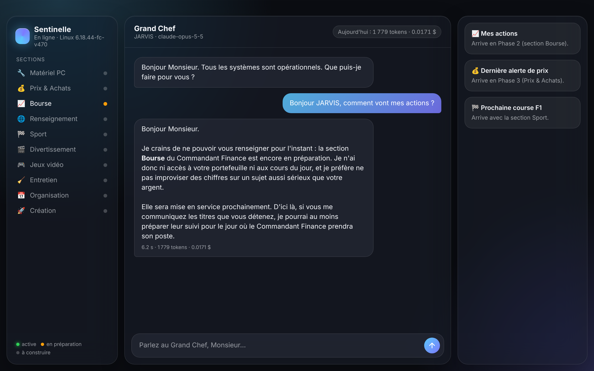

# Sentinelle — votre armée de 50 agents IA

Vous parlez à un seul agent, le **Grand Chef** (style JARVIS). Il dirige 10 commandants,
qui dirigent chacun 5 agents. Le plan complet est dans [SENTINELLE.md](SENTINELLE.md).



## Où en est-on ?

| Phase | Contenu | État |
|---|---|---|
| 1 | Fondations : serveur local, fenêtre Mac, Grand Chef qui répond | ✅ |
| 2 | Section Bourse (Commandant Finance + 5 agents, Yahoo Finance) | à venir |
| 3 | Prix & Achats (Galaxus, courbes de prix, alertes) | à venir |

## Comment ça marche (en 4 phrases)

1. La **fenêtre** (Tauri) affiche l'interface Liquid Glass et une icône dans la barre des menus.
2. Elle démarre en arrière-plan un **petit serveur Python**, qui n'écoute que votre Mac (adresse 127.0.0.1).
3. Le serveur transmet vos messages au **Grand Chef**, qui réfléchit grâce au Claude Agent SDK.
4. Chaque échange est noté dans `backend/data/journal/` (durée, tokens, coût) ; le total du jour s'affiche en haut de la discussion.

## Installation sur votre Mac (une seule fois)

Ouvrez l'app **Terminal** (Cmd+Espace, tapez « Terminal »), puis tapez ces commandes une par une :

1. **Outils Apple pour développeurs** (nécessaires pour compiler la fenêtre) :
   `xcode-select --install` → une fenêtre s'ouvre, cliquez « Installer ».
2. **Homebrew** (l'installateur de logiciels du Mac) — copiez la commande de [brew.sh](https://brew.sh).
   Il vous demandera **le mot de passe de votre Mac** : c'est normal, il installe des fichiers système.
   (Rien ne s'affiche pendant que vous tapez le mot de passe, c'est normal aussi.)
3. **Python et Node.js** : `brew install python@3.12 node`
4. **Rust** (le langage de la fenêtre Tauri) :
   `curl --proto '=https' --tlsv1.2 -sSf https://sh.rustup.rs | sh` → appuyez sur Entrée pour le choix par défaut,
   puis **fermez et rouvrez** le Terminal.

## La clé API Anthropic

Le Grand Chef a besoin d'une clé pour réfléchir.

1. Allez sur **platform.claude.com**, créez un compte (différent de l'abonnement claude.ai).
2. Menu **Billing** : ajoutez une carte et un petit crédit (5 $ suffisent pour commencer).
   Vous pouvez y fixer une **limite de dépense mensuelle** pour être tranquille.
3. Menu **API Keys** → **Create Key** → copiez la clé (elle commence par `sk-ant-`).
4. Au premier lancement, Sentinelle crée le fichier `.env` et l'ouvre : collez la clé après `ANTHROPIC_API_KEY=` et enregistrez.

**Ce que ça coûte** (on paie à l'usage, rien sans utilisation) :

| Rôle | Modèle | Prix par million de tokens (entrée / sortie) |
|---|---|---|
| Grand Chef | Claude Opus 5.5 (le plus puissant) | 4 $ / 20 $ |
| Agents simples (dès la Phase 2) | Claude Haiku 5.5 (le moins cher) | 0,10 $ / 0,50 $ |

En test réel, un message au Grand Chef coûte **1 à 2 centimes** (environ 1 800 tokens).
Avec 30 messages par jour, comptez environ 10 à 15 dollars par mois (un peu plus pour les longues conversations). Le compteur dans l'app vous montre la dépense du jour.

## Lancer Sentinelle

Double-cliquez sur **`Demarrer-Mac.command`**.

- La première fois, macOS peut refuser (« développeur non identifié ») : clic droit sur le fichier → **Ouvrir** → **Ouvrir**.
- La toute première ouverture prend 2 à 5 minutes (installation et compilation). Ensuite, quelques secondes.
- Fermer la fenêtre la **cache** seulement : Sentinelle reste dans la barre des menus (cliquez son icône pour la rouvrir).
  Pour quitter vraiment : Cmd+Q, ou le menu de l'icône → « Quitter Sentinelle ».

Sans la fenêtre, vous pouvez aussi lancer seulement le serveur :
`.venv/bin/python backend/main.py`, puis ouvrir **http://127.0.0.1:8765** dans Safari.

## Lancer les tests

```bash
.venv/bin/pip install -r requirements-dev.txt
.venv/bin/python -m pytest tests
```

Les tests utilisent un « faux cerveau » : ils ne coûtent rien et ne nécessitent pas de clé.

## Organisation des fichiers

```
sentinelle/
├── SENTINELLE.md            # le plan de référence
├── Demarrer-Mac.command     # lancement en double-clic
├── .env.example             # modèle du fichier de clé (le vrai .env n'est jamais publié)
├── backend/
│   ├── main.py              # serveur local (FastAPI, 127.0.0.1 seulement)
│   ├── grand_chef.py        # le Grand Chef (Claude Agent SDK)
│   ├── config.py            # lit le .env, modèles et prix
│   ├── journal.py           # journal des échanges et consommation
│   ├── sections.py          # les 10 sections et leur état
│   ├── commandants/  agents/  outils/   # rempli à partir de la Phase 2
│   ├── plateforme/mac/  plateforme/windows/   # code propre à chaque système
│   └── data/                # journal et base de données (restent sur votre Mac)
├── app/
│   ├── ui/                  # interface HTML/CSS/JS (Liquid Glass)
│   └── src-tauri/           # fenêtre native + icône de barre des menus (Rust)
└── tests/
```

## Sécurité

- Le serveur n'accepte que les requêtes venant de votre Mac lui-même.
- Le Grand Chef n'a **aucun outil** pour l'instant : il ne peut ni lire vos fichiers, ni naviguer, ni rien acheter.
- Il a pour consigne de ne jamais inventer de chiffres ni donner d'ordre de bourse.
